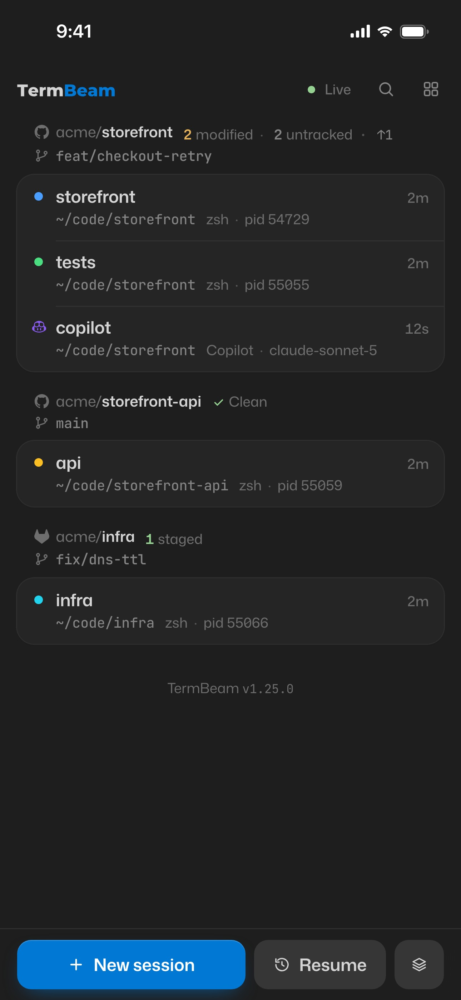
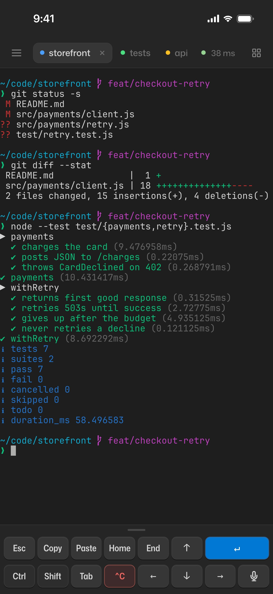
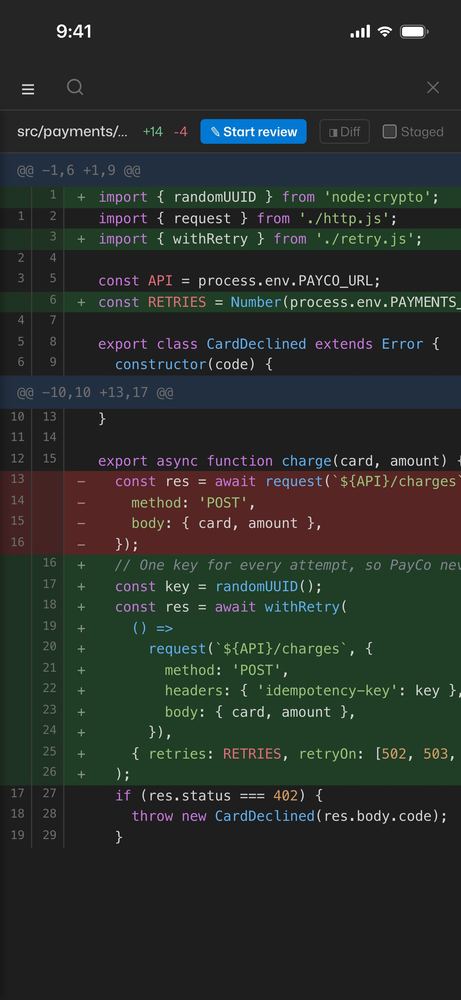
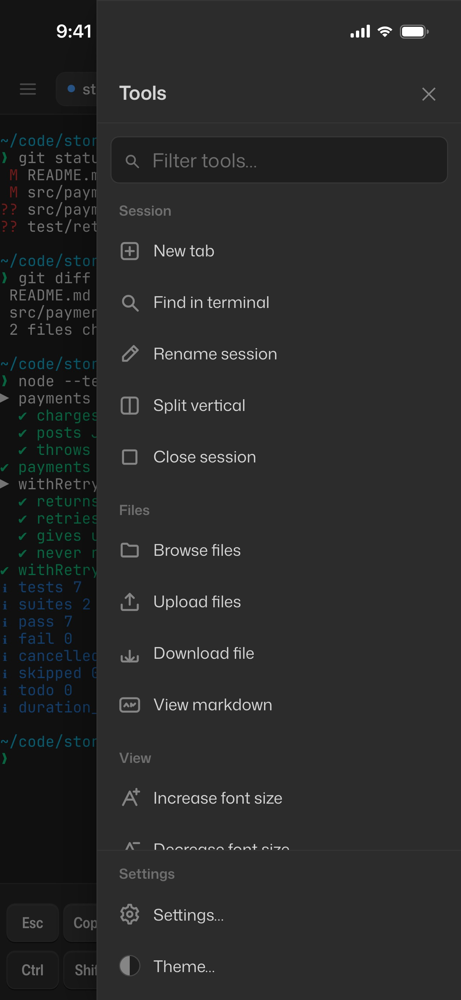
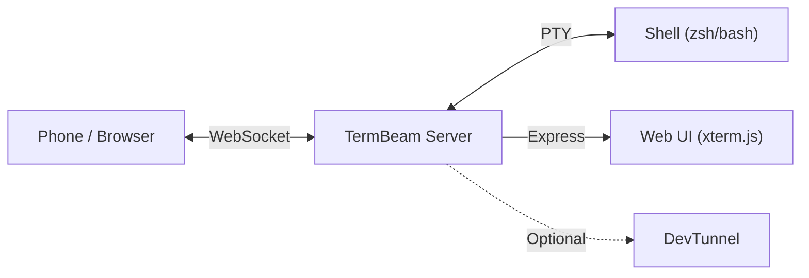

<div align="center">

# TermBeam

**Beam your terminal to any device.**

[](https://www.npmjs.com/package/termbeam)
[](https://www.npmjs.com/package/termbeam)
[](https://github.com/dorlugasigal/TermBeam/actions/workflows/ci.yml)
[](https://github.com/dorlugasigal/TermBeam/actions/workflows/ci.yml)
[](https://securityscorecards.dev/viewer/?uri=github.com/dorlugasigal/TermBeam)
[](https://nodejs.org/)
[](https://opensource.org/licenses/MIT)

</div>

TermBeam lets you access your terminal from a phone, tablet, or any browser — no SSH, no port forwarding, no configuration needed. Run one command and scan the QR code.

[Full documentation](https://dorlugasigal.github.io/TermBeam/)

https://github.com/user-attachments/assets/9dd4f3d7-f017-4314-9b3a-f6a5688e3671

### Mobile UI

<table align="center">
  <tr>
    <td align="center"></td>
    <td align="center"></td>
    <td align="center"></td>
    <td align="center"></td>
  </tr>
</table>

## Quick Start

```bash
npx termbeam
```

Or install globally:

```bash
npm install -g termbeam
termbeam
```

Scan the QR code printed in your terminal, or open the URL on any device.

```bash
termbeam                        # tunnel + auto-password (default)
termbeam --password mysecret    # custom password
termbeam --no-tunnel            # LAN only
termbeam -i                     # interactive setup wizard
```

## Features

### Mobile-First

- **No SSH client needed** — just open a browser on any device
- **Touch-optimized key bar** with arrows, Tab, Ctrl, Esc, copy, paste, and more
- **Swipe scrolling**, pinch zoom, and text selection overlay for copy-paste — full-screen apps like Copilot CLI keep mouse-wheel scrolling after reconnects
- **iPhone PWA safe-area support** for a native-app feel
- **Honest connection status** — one live pill with round-trip latency that explains _why_ when something's wrong (offline, computer asleep, tunnel sign-in expired, session locked) and fixes it in place

### Multi-Session

- **Tabbed terminals** with drag-to-reorder and live tab previews on hover/long-press
- **Split view** — two sessions side-by-side (auto-rotates horizontal/vertical)
- **Session colors and activity indicators** for at-a-glance status
- **Folder browser** for picking working directory, optional initial command per session

### Productivity

- **Terminal search** with regex, match count, and prev/next navigation
- **Tools panel** (Ctrl+K / Cmd+K) — right-hand slide-in with a filter box and every action, organized into **Session · Files · View · Share · Agents · Settings · System**. **Settings…** (Cmd/Ctrl+,) opens the Settings panel — theme, fonts, touch bar, workspaces, signed-in devices and passkeys — as a top sheet on phones and a right-hand drawer on desktop.
- **Customizable Touch Bar** — 8-column, multi-row (up to 3) key grid with drag-to-reorder, collapsible drawer, and a dedicated key editor (label, send payload, action, modifier).
- **Workspaces** — save named bundles of sessions (each with its own name, cwd, shell, color and initial command). Mark one as `default` and the **server** auto-spawns it on startup, so connecting any client lands on a ready terminal. Preferences (theme, fonts, defaults, custom keys, workspaces) are persisted server-side in `~/.termbeam/prefs.json` and sync across devices.
- **File upload** — send files from your phone to the session's working directory
- **File browser & download** — browse files in a session's working directory from the side panel and download them to your device
- **Markdown viewer** — preview `.md` files rendered with GitHub Flavored Markdown directly in the browser
- **Git changes view** — view git status, diffs, blame, and commit history in the code viewer. Toggle between Files and Changes tabs, view staged/unstaged diffs with syntax highlighting, and see per-line blame annotations
- **Push notifications** — get native push notifications on your phone when commands complete, even when the app is in the background. Uses Web Push API with VAPID authentication
- **In-app updates** — auto-update from the UI for npm/yarn/pnpm global installs, with copy-command fallback for other methods
- **Completion notifications** — browser alerts when background commands finish
- **38 color themes** (dark, light and neon) with adjustable font size
- **Port preview** — reverse-proxy a local web server through TermBeam
- **Image paste** from clipboard

### Secure by Default

- **Auto-generated password** with rate limiting and httpOnly cookies
- **Passkeys** — after the first login, unlock with Face ID / Touch ID / fingerprint instead of typing the password
- **Remembered devices** — sliding sessions that survive restarts (when the password is unchanged), listed and revocable in Settings → Security
- **QR code auto-login** with single-use share tokens (5-min expiry)
- **DevTunnel integration** for secure remote access — ephemeral or persisted URLs, with a watchdog that survives sleep/wake and re-creates expired tunnels
- **Cross-site protection** for the API and WebSocket, security headers (X-Frame-Options, CSP, nosniff) on app responses; only detected shells allowed

## How It Works

TermBeam starts a lightweight web server that spawns a PTY (pseudo-terminal) with your shell, serves a mobile-optimized [xterm.js](https://xtermjs.org/) UI via Express, and bridges the two over WebSocket. Multiple clients can view the same session simultaneously, and sessions persist when all clients disconnect.



## CLI Highlights

| Flag                  | Description                                     | Default        |
| --------------------- | ----------------------------------------------- | -------------- |
| `--password <pw>`     | Set access password                             | Auto-generated |
| `--no-password`       | Disable password protection                     | —              |
| `--tunnel`            | Create an ephemeral devtunnel URL               | On             |
| `--no-tunnel`         | Disable tunnel (LAN-only)                       | —              |
| `--persisted-tunnel`  | Reusable devtunnel URL (stable across restarts) | Off            |
| `--port <port>`       | Server port                                     | `3456`         |
| `--host <addr>`       | Bind address                                    | `127.0.0.1`    |
| `--lan`               | Bind to all interfaces (LAN access)             | Off            |
| `--public-url <url>`  | Your address when behind your own reverse proxy | —              |
| `--public`            | Allow public tunnel access (no Microsoft login) | Off            |
| `-i, --interactive`   | Interactive setup wizard                        | Off            |
| `--reset-auth`        | Sign out all devices and remove all passkeys    | Off            |
| `--log-level <level>` | Log verbosity (error/warn/info/debug)           | `info`         |

For all flags, subcommands, and environment variables, see the [Configuration docs](https://dorlugasigal.github.io/TermBeam/configuration/).

## Background Service

Run TermBeam as an always-on background service using the built-in PM2 integration:

```bash
termbeam service install     # interactive wizard — configures PM2, password, tunnel, boot auto-start
termbeam service status      # check process info, uptime, memory
termbeam service logs        # tail live logs
termbeam service restart     # restart after config changes
termbeam service uninstall   # stop and remove the service
```

The installer checks for [PM2](https://pm2.keymetrics.io/) (and offers to install it), then walks you through password, port, access mode, and boot auto-start options. Config is saved to `~/.termbeam/ecosystem.config.js`.

For systemd, launchd, and Windows Task Scheduler setup, see the [Running in Background docs](https://dorlugasigal.github.io/TermBeam/running-in-background/).

> 💡 **Keep the host awake** so the service stays reachable while you're away. macOS: pair with [Amphetamine](https://apps.apple.com/app/amphetamine/id937984704) (process trigger on `node`) or wrap with `caffeinate -dims`. Windows: enable [PowerToys Awake](https://learn.microsoft.com/windows/powertoys/) and disable network adapter power saving. Linux: use `systemd-inhibit` in your unit file. See [Keeping the Host Awake](https://dorlugasigal.github.io/TermBeam/running-in-background/#keeping-the-host-awake-) for the full setup.

## Security

TermBeam auto-generates a password and creates a secure tunnel by default, binding to `127.0.0.1` (localhost only). Each sign-in is a revocable device session in an `HttpOnly`, `SameSite=Strict` cookie (remembered devices: 7 days without use, 30 days max, stored only as hashes; without “Remember this device”: 2 hours idle, 12 hours max, never written to disk), passkeys give phishing-resistant one-tap unlock, login is rate-limited to 5 attempts per minute, QR codes contain single-use share tokens (5-min expiry), cross-site API and WebSocket requests are rejected, and security headers (X-Frame-Options, CSP, nosniff) are set on app responses (the `/preview` proxy passes the previewed app's own headers through). `termbeam --reset-auth` signs out every device and removes every passkey.

For the full threat model and safety checklist, see [SECURITY.md](SECURITY.md). For detailed security documentation, see the [Security Guide](https://dorlugasigal.github.io/TermBeam/security/).

## Contributing

Contributions welcome — see [CONTRIBUTING.md](CONTRIBUTING.md).

## Changelog

See [CHANGELOG.md](CHANGELOG.md) for version history.

## License

[MIT](LICENSE)

## Acknowledgments

Special thanks to [@tamirdresher](https://github.com/tamirdresher) for the [blog post](https://www.tamirdresher.com/blog/2026/02/26/squad-remote-control) that inspired the solution idea for this project, and for his [cli-tunnel](https://github.com/tamirdresher/cli-tunnel) implementation.
